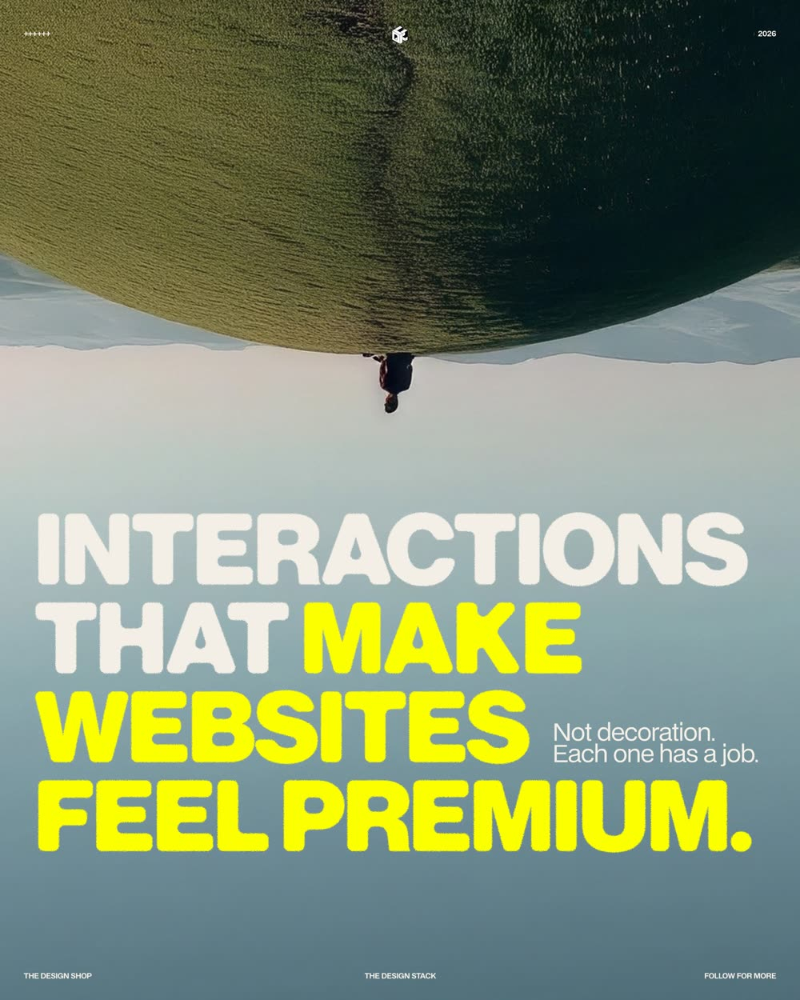
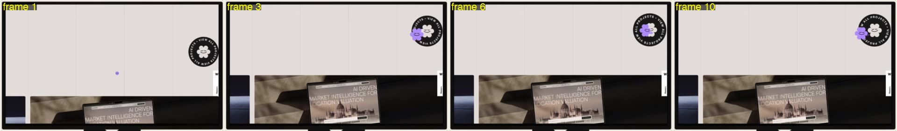
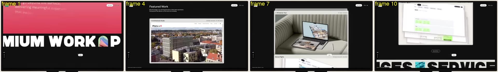
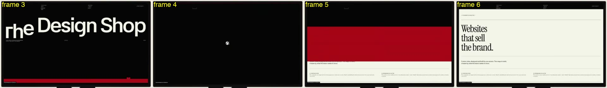
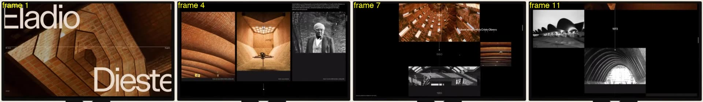
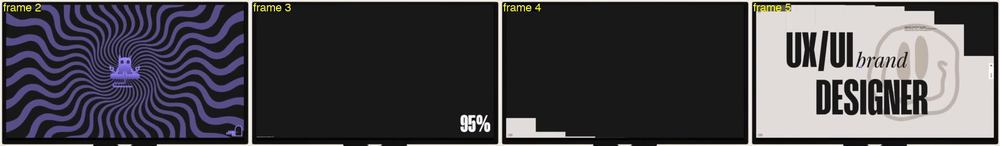
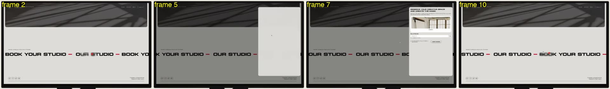

# Video lessons, third batch: what makes a site feel premium

Source: Satyam Dubey (Web Designer), Instagram post by thedesignshop.tds, https://www.instagram.com/p/De1gtsHD0zB/, reviewed 2026-10-28. Reviewed from the public caption, the three image slides and six short screen-recording clips sampled at 2 frames per second (frame N is at about (N-1) x 0.5 s; 720 px wide frames; no audio transcribed). The clips show a website inside a monitor mockup, so the page itself is small in each frame; anything finer than that is marked unknown.

Read this with the [first add-on](VIDEO_LESSONS_ADDON.md) and the [second batch](VIDEO_LESSONS_BATCH2.md). It adds no rows and changes no tier. The six interactions belong to the motion gate and to the final polish pass (§7 of the prompt). In a clone run they are copied only when the reference shows them, with the reference's measured timing (MOT-11). The polish pass may not add any of them (§7 invariant 4), and the rest state must not move (§7 invariant 3), which is why every effect below must start from a pointer or scroll event and never from page load. In a template run outside the clone prompt, they are brief decisions recorded in DEL-16. The captions below that say "the author's claim" are the author's opinion, not measured results.

Clips are named by carousel position (2, 3, 4, 6, 7, 8). Positions 1, 5 and 9 are image slides (the cover and two text slides), so there is no clip 5. The caption lists the interactions in a different order from the clips, so each lesson below says its clip number.

## 1. Magnetic buttons (clip 2)

**Observed (frames 1 to 11, 0 to 5.0 s).** A dark round badge with a flower mark and ring text "VIEW ALL PROJECTS" sits at the right edge of the screen. Frames 1 and 2 (0 to 0.5 s): the cursor is a small purple dot about 40% of the screen width to the left of the badge. Frame 3 (1.0 s): the cursor has become a larger purple flower-face mascot and overlaps the badge's left rim. Frames 4 to 6 (1.5 to 2.5 s): the mascot sits inside the badge, left of centre. Frames 7 and 8 (3.0 to 3.5 s): it is at the top of the badge. Frame 9 (4.0 s): back left of centre. Frame 10 (4.5 s): at the left rim, partly outside. Frame 11 (5.0 s): the mascot is nearly transparent and a small dot returns, left of the badge. The ring text sits at different angles from frame to frame, so it rotates. Whether the badge itself is pulled toward the pointer: unknown. In cropped views its centre varies by roughly 5 to 15 px of the 720 px frame, but the recording also pans slightly between frames 1 and 2, so that number is not a measurement of pull.

**Author's claim.** Magnetic buttons make the interface feel as if it responds "to you specifically."

**Rule for our builds.** Use on one or two primary actions per page, with the pull limited to a few pixels to a fraction of the button's size and a smooth return to rest when the pointer leaves. It feels cheap when many buttons pull, when the pull is large or springy, when the hit area visibly shifts under the pointer, or when it runs on touch or with reduced motion.

**Rows.** MOT-08 (precise hover only, never replaces controls), A11Y-13 (custom cursor must not hide targets or the system cursor), A11Y-09 (reduced motion), UXF-06 (touch), UXF-01 (the button still does its stated action), RSP-05 (target size does not shrink while moving), MOT-14 (passive listeners), MOT-02 and MOT-15 (transform-only motion, no long tasks), A11Y-05 (keyboard focus ring unchanged).

**Evidence to record.** In the motion gate: a pointer path over and away from each magnetic control with the measured maximum offset in px and the time to return to rest; the same control with `pointer: coarse` and with reduced motion, showing no offset; a keyboard focus capture showing the focus ring and the control at rest; a rest-frame diff showing zero pixels (pointer never moved onto the page).

## 2. Staggered scroll (clip 3)

**Observed (frames 1 to 11, 0 to 5.0 s).** Frame 1 (0 s): a pink panel with faint body text at the top and a black-and-white wide marquee line ("...MIUM WORK ...") moving across. Frames 2 and 3 (0.5 to 1.0 s): the section turns black, a small "Featured Work" heading appears, and the first project card (a browser mockup) enters from the bottom, partly cropped. Frame 4 (1.5 s): card 1 is centred and whole. Frame 5 (2.0 s): card 2 enters from the bottom over card 1, while card 1 shrinks and moves up. Frame 6 (2.5 s): card 2 is whole. Frame 7 (3.0 s): card 3 enters from the bottom. Frames 8 and 9 (3.5 to 4.0 s): card 3 fills the view with cards 1 and 2 as thin tilted edges above it. Frames 10 and 11 (4.5 to 5.0 s): the stack tilts back in perspective and moves up while a "SERVICES" marquee rises from the bottom. Each handover takes about 1 s (two frames) with about 1 s of hold between. What drives it (scroll, wheel or autoplay): unknown, no input is visible. No cursor is readable.

**Author's claim.** Staggered scroll "paces how fast you take in information."

**Rule for our builds.** Use it to deliver items one at a time where order matters: cards, list rows, headline lines. Keep the step between items short (tens of milliseconds for a line or list, about a second per full card as seen here), the total sequence short enough that nobody waits for content, and the reveal played once. It feels cheap when a long chain makes the visitor wait, when items reserve no space and the page shifts, or when content is invisible without JavaScript.

**Rows.** MOT-01 (usable under load), MOT-03 and MOT-04 (ScrollTrigger and Lenis wiring and cleanup), MOT-11 (time-based, checked at several refresh rates), MOT-02 (animated properties), A11Y-09 (reduced motion shows the final state), UXF-08 (content stays real DOM text), SPD-01 (CLS stays within budget), MOT-10 (ready flag so tests do not sleep).

**Evidence to record.** The measured per-item delay and total duration for each staggered group in the motion report; frames at 0 ms, the middle and the end of one group; CLS from the motion run; a reduced-motion capture with everything visible; a no-JavaScript or failed-script capture where the content remains readable (EDGE-05).

## 3. Page transitions (clip 7)

**Observed (frames 1 to 6, 0 to 2.5 s; the clip is 3.0 s long).** Frames 1 and 2 (0 to 0.5 s): a black home screen with a very large "The Design Shop" wordmark and a small red button at the bottom right. Frame 3 (1.0 s): the wordmark's letters have started to move one by one (the first "T" sits lower than its neighbours) and a red bar spans the bottom of the screen. Frame 4 (1.5 s): an almost empty black screen with the small logo mark at the centre. Frame 5 (2.0 s): a red band crosses the middle of the screen with black above it and the new cream page showing below. Frame 6 (2.5 s): the new page is whole ("Websites that sell the brand."). From the click to the settled page is about 1.5 s. The red band is lower in frame 3 and higher in frame 5, which suggests it travels upward, inferred from two positions only. No cursor is readable.

**Author's claim.** Page transitions keep you "inside one continuous experience."

**Rule for our builds.** Use one transition style for all routes, with a designed device carrying the eye (a band, a mask, the logo) and a total under about 1.5 s. Real navigation, title, focus and scroll position stay correct underneath. It feels cheap when the effect plays twice, when it hides a slow page behind a delay, or when back and forward break.

**Rows.** MOT-07 (record behaviour, no duplicate entrance), A11Y-12 (new view announced, title and focus), SPD-09 (an intro or transition can be bypassed and cannot trap the task), SPD-11 (back and forward restoration), A11Y-09 (reduced motion replaces the effect with an instant or fade change), UXF-01, MOT-12 and EDGE-05 (a failed asset leaves a usable page).

**Evidence to record.** Route-change captures at about 0, 0.5 s, the middle and the end for every route pair in scope; the served document title and the focused element after each change; a back and forward test; a count of entrance animations per transition; the reduced-motion version; a page with the transition script blocked.

## 4. Controlled parallax (clip 4)

**Observed (frames 1 to 12, 0 to 5.5 s).** Frame 1 (0 s): a hero with "Eladio" top left and "Dieste" bottom right over a brick vault photo. Frame 2 (0.5 s): the photo has grown across the screen with a paragraph at the bottom. Frame 3 (1.0 s): a black page with the paragraph at the top and three empty dark boxes below (images not yet shown; whether that is loading or a transition: unknown). Frame 4 (1.5 s): the three images are in place (vault, interior, portrait). Frame 5 (2.0 s): the row has moved up, an "Obras" heading and a thin vertical line with the year 1947 appear. Frames 6 to 12 (2.5 to 5.5 s): a vertical line with years (1947, 1958, 1960, 1965, 1973, 1974) runs down the centre, and images of different sizes sit at different horizontal and vertical offsets around it, with one large image near the centre and smaller ones to the sides. Each half second the layout shows different images or new offsets. At 2 fps this reads as swaps and large moves more than a continuous drift, so the speed ratio between layers is unknown and is not claimed.

**Author's claim.** Controlled parallax is "felt more than noticed", and overdone parallax is what people complain about.

**Rule for our builds.** Use small, consistent offsets: a background or image layer moving a modest fraction of the scroll distance (record it, for example 0.1 to 0.3), on a few layers per section, never on text that must be read while it moves. It feels cheap when layers move fast, when it makes text hard to read, when it drops frames, or when it produces a horizontal scrollbar.

**Rows.** A11Y-09 (parallax removed under reduced motion), MOT-01 and MOT-15 (usable under load, no long tasks), MOT-02 (transform and opacity only), MOT-06 (resize and rotation leave no stale offsets), MOT-11 (time- and scroll-based, not frame-counted), RSP-02 and RSP-03 (no horizontal overflow from offset layers), SPD-01 (CLS).

**Evidence to record.** The layer-to-scroll ratio and the maximum offset in px for each parallax layer in the motion report; a scroll trace on the agreed device profile; frames at three scroll positions from the same layer; the reduced-motion capture; a resize and rotation check with no overflow.

## 5. Easter eggs (clip 6)

**Observed (frames 1 to 6, 0 to 2.5 s; the clip is 3.0 s long).** Frames 1 and 2 (0 to 0.5 s): a dark screen with purple wavy lines radiating from a small meditating monster mascot at the centre; in frame 2 the lines are much thicker, so they are animated. A small stairs-like icon sits at the bottom right. Frame 3 (1.0 s): a black screen with a "95%" counter at the bottom right. Frame 4 (1.5 s): black with a white stepped block growing in the bottom left. Frame 5 (2.0 s): the home page ("UX/UI brand DESIGNER", a smiley outline) with a black stepped block leaving at the top right. Frame 6 (2.5 s): the page settled. What triggered the swirl, and whether it is a hidden scene or a pre-loader, is unknown; the clip shows only the order swirl, counter, home page. The slide's own title reads "Ester Eggs".

**Author's claim.** Easter eggs reward curiosity; a site with nothing to discover feels "built to be used once and forgotten."

**Rule for our builds.** Add at most one, in a quiet place, with a trigger that never blocks the primary journey, and make it truthful and on brand. In a clone run it is a reference feature to copy, never an addition. It feels cheap when it is a pop-up, when it needs a secret to reach essential content, when it flashes or plays sound, or when it carries an invented claim or joke about the client.

**Rows.** UXF-07 (no deception or intrusive overlay), UXF-01 (nothing essential depends on it), A11Y-05 (keyboard and focus if it is interactive), A11Y-09 and A11Y-10 (motion and pause), A11Y-14 (no unmuted sound before an activation), SPD-08 (loaded only when used), CNT-04 and CNT-11 (no unapproved facts or placeholder text in the shipped artifact), EDGE-05.

**Evidence to record.** Where it is triggered and how (route, element, input); a capture of it opening and closing; the weight loaded only for it; reduced-motion behaviour; a note that the primary journey was completed without it; the client's approval of any wording in it.

## 6. Cursor with context (clip 8)

**Observed (frames 1 to 10, 0 to 4.5 s).** A grey page with a wide marquee line "BOOK YOUR STUDIO - OUR STUDIO - BOOK YOUR STUDIO" drifting to the left (about 15 to 30 px per half second at 720 px frame width, estimated from the text positions). The cursor is a small red dot with a tiny pill-shaped label beside it; the label's text is unreadable (unknown). In frames 9 and 10 the ordinary arrow pointer is also visible next to the dot, so the system cursor is not hidden and the dot follows with a small offset. In frames 2, 4 and 10 (0.5, 1.5, 4.5 s) the letters under the dot are blurred over about three letters wide, a lens effect. Frame 5 (2.0 s): the page dims and a blank white panel appears at the right (a click opened a dialog). Frames 6 and 7 (2.5 to 3.0 s): the panel shows a heading about reserving a creative space, a photo, a date field and a submit button. Frame 8 (3.5 s): the panel is gone and the page is undimmed. Whether the click or something else opened and closed the dialog: unknown.

**Author's claim.** A cursor with context "tells you what's possible before you commit."

**Rule for our builds.** Use it on a precise-pointer device to say what the next click does (view, drag, play, open), by changing the cursor's shape or label over those targets only. Keep the system cursor visible, keep the same information in the control's own accessible name, and drop the effect on touch and under reduced motion. It feels cheap when the dot lags so much that it points at the wrong thing, when the label is the only place a meaning appears, or when blur or size hides what is under it.

**Rows.** MOT-08 (precise hover only, never replaces controls), A11Y-13 (no hidden system cursor, no obscured targets, off on touch and reduced motion), A11Y-17 (hover content dismissible, hoverable, persistent), RSP-07 (hover-only meaning has a touch equivalent), UXF-06 (touch), A11Y-05 (keyboard equivalent), MOT-14 and MOT-15 (listeners, long tasks), A11Y-09.

**Evidence to record.** A table of cursor states in the motion report (default, link, media, drag, label text) with the target each applies to; pointer captures over each; a touch profile and reduced-motion capture showing no custom cursor; a check that the target under the cursor stays readable and clickable; the accessible names of the controls the labels describe.

## Summary

| Interaction | Rows | Evidence |
| --- | --- | --- |
| Magnetic buttons (clip 2) | MOT-08, A11Y-13, A11Y-09, UXF-06, UXF-01, RSP-05, MOT-14, MOT-02, MOT-15, A11Y-05 | Maximum offset and return time per control; touch and reduced-motion show none; focus capture; zero-pixel rest diff |
| Staggered scroll (clip 3) | MOT-01, MOT-03, MOT-04, MOT-11, MOT-02, A11Y-09, UXF-08, SPD-01, MOT-10, EDGE-05 | Per-item delay and total per group; frames at three times; CLS; reduced-motion and no-script captures |
| Page transitions (clip 7) | MOT-07, A11Y-12, SPD-09, SPD-11, A11Y-09, UXF-01, MOT-12, EDGE-05 | Captures per route pair; title and focus after change; back and forward; one entrance per change |
| Controlled parallax (clip 4) | A11Y-09, MOT-01, MOT-15, MOT-02, MOT-06, MOT-11, RSP-02, RSP-03, SPD-01 | Layer ratio and maximum offset in px; scroll trace; reduced-motion capture; no overflow on resize |
| Easter eggs (clip 6) | UXF-07, UXF-01, A11Y-05, A11Y-09, A11Y-10, A11Y-14, SPD-08, CNT-04, CNT-11, EDGE-05 | Trigger and capture; weight loaded only for it; primary journey done without it; approved wording |
| Cursor with context (clip 8) | MOT-08, A11Y-13, A11Y-17, RSP-07, UXF-06, A11Y-05, MOT-14, MOT-15, A11Y-09 | Cursor state table; captures over each target; touch and reduced-motion show none; accessible names |

## Gaps

- No row says how to judge whether an interaction is premium. The rows above test safety, performance and accessibility, not taste. The reference comparison (MOT-11) and the founder's eye remain the only measure of feel.
- No row sets a numeric limit for magnetic pull, stagger step, parallax ratio or transition duration. The numbers above are rules for our builds from this source, not checklist thresholds; record the chosen value per site.
- No row covers an easter egg as a feature. UXF-07, UXF-01 and the content rows constrain it, but nothing requires its existence or its approval except CNT-04.
- The clips do not show timing finer than 0.5 s, the scroll or pointer input behind each effect, or any exact distances. Treat the quoted timings as sampled observations, not measurements.
